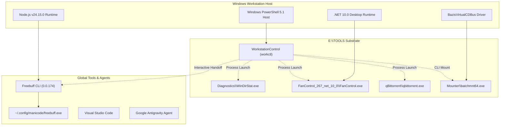

# E:\TOOLS Dependency & Architecture Map

## Overview
The `E:\TOOLS` directory serves as the workstation's dedicated local software, tool, and control substrate. It hosts standalone binaries, hardware control utilities, disk diagnostics, virtual disk mounters, and the central control plane (`WorkstationControl`).

---

## Component Taxonomy & Dependency Relationships

---

## Detailed Component Dependency Specifications

| Component | Physical Path | Runtime Dependency | Network / Ports | Governance Policy |
|---|---|---|---|:---:|
| **WorkCtl** | `E:\TOOLS\WorkstationControl\workctl.ps1` | Windows PowerShell 5.1 | None | `PROTECTED` |
| **WinDirStat** | `E:\TOOLS\Diagnostics\WinDirStat.exe` | Native Win32/x64 | None | `LAUNCH` |
| **FanControl** | `E:\TOOLS\FanControl_267_net_10_0\FanControl.exe` | .NET 10.0 Desktop | Named Pipes (IPC) | `LAUNCH` |
| **qBittorrent** | `E:\TOOLS\qBittorrent\qbittorrent.exe` | Qt6 / C++ | TCP 8080 (optional WebUI) | `LAUNCH` |
| **WinCDEmu Mounter** | `E:\TOOLS\Mounter\batchmnt64.exe` | Native Driver (`bazisvirtualcdbus`) | None | `LAUNCH` |
| **Freebuff** | `C:\Program Files\nodejs\freebuff.ps1` | Node >= 16 + Zig-Bun engine | Cloud LLM Gateway (HTTPS) | `LAUNCH` |

---

## Lifecycle Governance Boundaries
1. **PROTECTED**: WorkCtl itself and Antigravity. WorkCtl never allows stopping, killing, or destabilizing its own supervisor or host process.
2. **MANAGED**: Workloads and services with health probes, start/stop hooks, and port monitoring (e.g. Sonarr, Torlink, MySQL, Redis).
3. **LAUNCH**: Standalone desktop GUIs and on-demand interactive CLIs. WorkCtl initiates process or handles terminal handoff, but leaves execution lifecycle to the operator.
4. **CONFIRM**: Mutating lifecycle operations that require operator acknowledgment before stopping.
