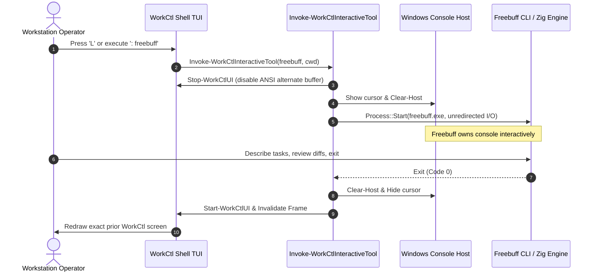

# WorkCtl Freebuff Integration Specification

## 1. Unified Integration Endpoints
Freebuff is exposed through two complementary WorkCtl surfaces that share the exact same underlying adapter:

1. **Tools Catalog (`WORKCTL > TOOLS > AI / AGENTS > FREEBUFF`)**:
   - Status, version, binary path, runtime, capabilities, privacy notice.
   - Actions: `[L] Launch in Current Directory`, `[P] Choose Project`, `[I] Info`, `[G] Guide`, `[B] Back`.
2. **Development Subsystem (`WORKCTL > DEVELOPMENT > PROJECTS > [PROJECT]`)**:
   - Inspects target project (e.g. `AI-Bridge`, `termux-ai-workstation`).
   - Actions: `[F] Launch Freebuff in Project`, `[T] Open Terminal`, `[C] Open VS Code`, `[G] Git Status`.
3. **Command Mode Grammar**:
   - `: freebuff` -> Launches Freebuff in current active directory (`$state.CurrentDirectory`).
   - `: freebuff <project>` -> Launches Freebuff inside `E:\Workspace\<project>`.
   - `: agents` -> Navigates to AI Coding Agents screen.

---

## 2. Terminal Handoff Protocol (`Invoke-WorkCtlInteractiveTool`)

---

## 3. Data Flow & Security Constraints
- WorkCtl does **not** pipe secrets or credentials to Freebuff.
- Freebuff runs with the working directory set strictly to the chosen project directory (`--cwd`).
- No permanent daemon or port is spawned.
