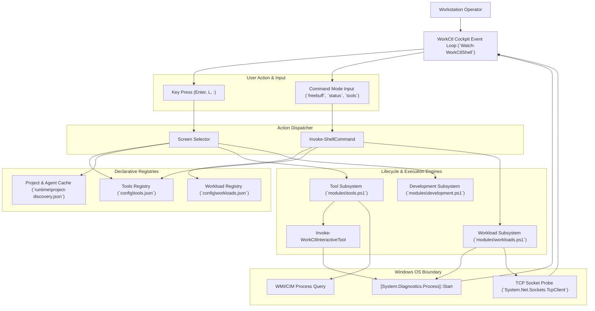

# WorkCtl Management Architecture & Lifecycle Model

## 1. Architectural Philosophy
WorkCtl is a hybrid control plane combining:
1. **Interactive Differential TUI Cockpit**: Sub-20ms responsive keyboard navigation, instant screen switches, status headers, and contextual preview cards.
2. **Deterministic Service & Tool Registries**: Declarative JSON schemas (`workloads.json` and `tools.json`) providing single sources of truth.
3. **Multi-Tiered Governance & Safety Shields**: Hard blocks on critical processes (`antigravity`, `powertoys`), confirmation prompts on sensitive workloads (`discord`), and safe execution for unmetered tools.
4. **Subprocess Terminal Handoff**: Clean delegation of terminal ownership for interactive CLI agents (`freebuff`) without differential renderer corruption.

---

## 2. End-to-End Execution Call Graph

---

## 3. Workload vs. Tool Lifecycle Semantics

| Dimension | Managed Workload (`workloads.json`) | Managed / External Tool (`tools.json`) |
|---|---|---|
| **Lifecycle Model** | Continuous background daemon (`ALWAYS_ON` or `ON_DEMAND`) | Ephemeral process or operator-driven GUI (`ON_DEMAND_TOOL`) |
| **Startup Semantics** | `Start-Workload <name>` (Service or background process) | `Invoke-WorkCtlInteractiveTool` or `[Process]::Start` |
| **Shutdown Semantics** | `Stop-Workload <name>` (Graceful stop or taskkill) | Operator exits CLI/GUI, or `manual` stop policy |
| **Health Probes** | TCP port check (300ms timeout) + Process matching | Process list inspection + optional WebUI probe |
| **Governance** | Safe / Confirm / Explicit policy enforcement | Launch / Protected policy enforcement |
| **Idle Resource Footprint** | Resident process memory (e.g. MySQL, Sonarr) | **0 RAM, 0 daemons, 0 resident background ports** |

---

## 4. Subprocess Terminal Handoff Protocol

When an interactive CLI application (such as Freebuff) is launched:
1. **Suspension**: WorkCtl stops the active UI rendering stream via `Stop-WorkCtlUI`.
2. **Terminal Normalization**: `[Console]::CursorVisible = $true; Clear-Host`.
3. **Process Attachment**: Launches the target CLI with `UseShellExecute = $false` and unredirected standard handles so it attaches directly to the console host.
4. **Handoff Wait**: Blocks synchronously while the operator interacts with the agent.
5. **Re-acquisition**: Catches process exit code, calls `Clear-Host; [Console]::CursorVisible = $false`.
6. **Cockpit Redraw**: Re-initializes UI with `Start-WorkCtlUI`, invalidates `$script:UiPreviousFrame`, and repaints the prior cockpit screen seamlessly.
